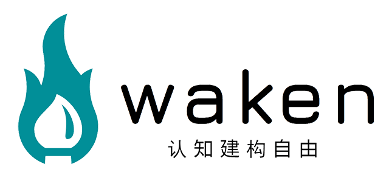

# Awaken



一个多端同步阅读软件：

1. 支持桌面（Windows、macOS、理论Linux）和移动端（安卓、iOS）。
2. 基于**WebDAV**的书籍管理，支持进度、笔记、书签同步，并且支持从**Kindle**导入笔记。
3. 仅支持**EPUB**电子书，其他的可以自行转换，例如[一键批量下载 Kindle 全部电子书工具 + 移除 DRM 解密插件 + 格式转换教程 (开源免费)](https://www.iplaysoft.com/kindle-download-dedrm.html)。

**本项目不接任何需求，但是欢迎任何BUG修复或功能性的PR，当然那种什么代码不符合你的审美改改格式、改改先进的构建工具之类的还是算了，恕我懒得处理**。

技术教程见：

[Awaken-基于Hybrid方案和WebDAV的全平台开源阅读软件](https://zhuanlan.zhihu.com/p/594798266)

功能展示见视频：

[](https://www.bilibili.com/video/BV1uD4y1j79i/)

## 应用包

详见[Change Log](./CHANGELOG.md)。

## 开发

前置需求：

1. NodeJS v20（本次构建使用 20.20.2）
2. Rust环境

首先`Clone`整个仓库，初始化项目：

```sh
npm run init
```

>现有 UIKit 使用旧版 React peer 声明，安装时使用 `npm install --legacy-peer-deps`。已提交锁文件，复现构建可使用 `npm ci --legacy-peer-deps`。

接着运行开发指令：

```sh
npm run dev
```

然后查到**本机IP地址**，记`DEV_URL = ${IP}:8888`，分平台处理：

### 桌面端

在对应的操作系统上，执行一句命令即可：

```sh
npm run dev-desktop
```

但注意需要在**非虚拟机包括WSL**环境执行。

### 安卓端

用最新的**Android Studio**打开**platform/android**下的工程，然后修改`MainActivity.kt`中的字段：

```kotlin
private val host: String = "http://${DEV_URL}"
```

接着连上设备调试即可。

### iOS端

用**XCode**打开**platform/ios**下的工程，然后修改`ContentView.swift`中的字段：

```kotlin
let host: String = "http://${DEV_URL}"
```

接着连上设备调试即可。

## 测试

数据保存与同步的自动化回归测试：`npm test`。类型检查：`npx tsc --noEmit`。

可选的阅读器浏览器回归测试：安装 `playwright-core` 及其 WebKit 运行时后，运行 `node tests/selection.browser.cjs`。可用 `AWAKEN_PLAYWRIGHT_MODULE` 指定外部安装路径，`PLAYWRIGHT_BROWSERS_PATH` 指定浏览器缓存目录。测试使用临时生成的 EPUB，验证选区、高亮、编辑、删除、重开恢复和跨页操作。

书库顶部显示本地保存和同步状态，失败后可重试。未下载的书籍可通过卡片上的“下载到本机”单独下载；离线时仍可阅读已下载书籍，修改会保留为待同步状态。

Kindle 笔记导入使用完整引文匹配，支持跨段落、行内样式、排版空白、重叠和乱序标注。预定位 CFI 只有在书籍哈希及选区全文校验通过时才会使用；重复导入保留已有备注。可运行 `node tests/note-search.browser.cjs` 验证定位、备注合并和资源释放（Playwright 环境同上）。

点击书库顶部“同步全部”，可一次同步所有书架的书目、笔记、书签和阅读进度，并将全部 EPUB 下载到本机。处理时显示当前书名与数量进度，已有 EPUB 会跳过；单书下载失败后继续处理其余书籍，完成后列出失败项。点击顶部“重试同步”可再次尝试，已下载的文件会保留。原有“同步”保持书目与本机待上传修改的同步方式，正文仍按需下载。

导入时会跳过完全相同的文件，并集中提示同名同作者的不同 EPUB。默认保留已有记录；确实需要另一个版本时，可在“导入结果”中勾选后单独导入。不同版本的笔记、进度不会自动合并。可运行 `node tests/import.browser.cjs` 验证真实 EPUB 导入和联网书架移动（Playwright 环境同上）。

点击书籍下方“移入书架”，直接选择已有书架即可移动；输入名称可搜索书架，或一步“新建并移入”。当前书架和各书架的书籍数量会显示在列表中。移动后可点“查看书架”跳转，离线修改仍会保存到本机。可选的界面回归测试：先运行 `npm run build`，再用与阅读器测试相同的 Playwright 环境运行 `node tests/shelves.browser.cjs`。

WebDAV 地址支持服务根目录（如 `https://dav.jianguoyun.com/dav/`）或直接指向书库（如 `https://dav.jianguoyun.com/dav/Awaken/`），程序会自动识别已有 `books.json`。同步成功后显示书目数量；书目和封面会拉到本机，EPUB 正文按需下载。

含半角冒号等受限字符的书名，上传时会在书籍哈希目录内使用 `book.epub`，原书名和本机文件不变。索引中的 `remoteFile` 记录实际远端文件名，其他设备需更新到 1.0.6 或之后的版本才能下载这类新上传的书籍；已有书库仍兼容原来的文件名。

桌面端会保存最近 500 条 WebDAV 请求日志，包括时间、方法、路径、HTTP 状态码、耗时及服务器错误详情。macOS 路径为 `~/Library/Logs/com.dtysky.Awaken/webdav.log`，可在 Finder 的“前往文件夹”中打开。日志不记录认证头、请求正文或 URL 查询参数；分享时可自行遮盖书名和服务器地址。书库内的 `sync-state.json` 仍保存最后一次同步状态。

测试很简单，如果实在桌面端，需要你一开始选择一个空目录作为本地书籍存储，可以选择**test/client**目录，接着在主界面的**设定**中，填入以下配置：

1. 地址：http://${IP}:8889/dav/
2. 用户名：dtysky
3. 密码：114514

确认后即连接到本地调试服务器，接下来你可以在**test**目录中找到一些测试用书籍，来测试添加、删除、阅读等等功能。本地测试服务器的文件落在了**test/server/dav**下。

## 发布

发布首先要执行指令：

```sh
npm run build
```

然后分平台处理：

### 桌面端

直接执行：

```sh
npm run release-desktop
```

即可，但同样需要在**非虚拟机包括WSL**环境执行。如果只发布桌面端，也可以直接执行：

```sh
npm run release
```

产物在`platforms/desktop/target/release/bundle`中。

### 安卓端

打开项目工程，在`Build` -> `Select Build Variants`窗口，设置选择为`release`模式，然后`Build` -> `Generate Signed Build or APK`即可，可能需要重新生成签名文件。

产物在`platforms/android/app/release`中。

### iOS端

打开项目工程，构建的`schema`选择`release`即可。

## todo

1. 移动端，默认选择文本后的弹窗行为。
2. 书籍列表分页。
3. 书籍列表搜索。

## Copyright

**Copyright © 2022, 戴天宇, Tianyu Dai (dtysky < dtysky@outlook.com >). All Rights Reserved.**
**This project is free software and released under the** [GNU Lesser General Public License (LGPL)](https://www.gnu.org/licenses/lgpl-3.0.en.html).
